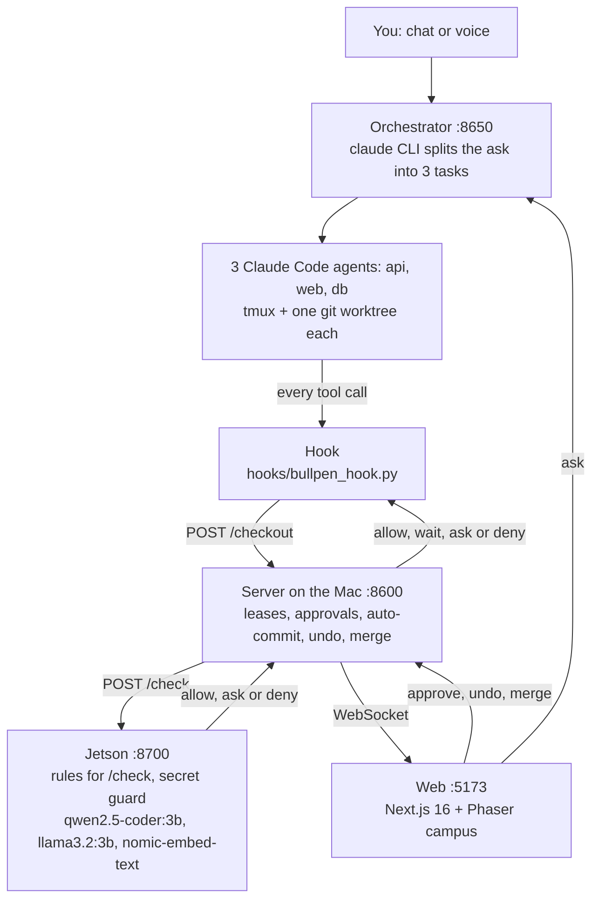

# Bullpen

Bullpen is version control for AI agents. Tell one orchestrator what you want; it spins up Claude Code agents on your own sub, and a Jetson referee checks every edit with file locks, human approval, auto-commits, and per-agent undo, all live on a pixel campus.

Built at HackJam '26 (USF Tampa, Nov 21, 2026). Track: Best Overall.

## What it is and why

Git was built for humans. Put three AI agents on one repo and they overwrite each other, and you cannot see what any of them is doing.

Bullpen gives each agent its own git worktree and branch, and puts a referee in front of every edit:

- **File leases.** One agent holds a file at a time. A second agent waits.
- **Guarded folders.** An edit in `db/` needs a human to approve it. No answer in 60 seconds means deny.
- **Auto-commit per edit.** Every edit is a commit with `Bullpen-Agent` and `Bullpen-Task` trailers.
- **Per-agent undo and merge.** Undo one agent's whole branch, or merge it through an intent card.
- **Ask why.** Ask what an agent is doing and get an answer from local history.
- **A live map.** The repo is the USF campus: each folder is a building, `main` is the campus, and each agent's branch is a colored layer on top.

The agents run on your own Claude subscription through the `claude` CLI, with no API key. The referee runs on a Jetson, which is separate hardware the agents cannot reach. It is always on and it fails closed: unplug it and every edit stops. Its local models write the commit messages and summaries, so that work costs no subscription usage and the history stays private.

> Your sub writes the code. The Jetson keeps it honest, free, and private.

## What you see, and what is real underneath

The pixel campus is the hero. Next to it is a live evidence panel, and every animation on the map maps to real data:

| Panel | What it shows | Where it comes from |
|---|---|---|
| Commit timeline | Each agent's commits, with Undo and Merge per agent | Real git commits with `Bullpen-Agent` and `Bullpen-Task` trailers |
| Leases and approvals | Who holds which file, the countdown, who waits, what needs your approval | The server's lease table |
| Jetson referee log | Every decision with the matched rule, latency and model. Unplug the Jetson and it shows OFFLINE, and every edit is denied | The Jetson's `/check` replies |
| Building click | Zooms inside: rooms are subfolders or hot files, each agent sits at the file it is editing under a sign with its branch, with a live log of its actions and the real diff | Leases, hook events, `git diff main...<branch>` |

**Point it at any repo and it builds your campus.** A small deterministic generator scans the repo, ranks the top-level folders by file count, and puts the top 8 into fixed USF building slots. Everything else goes into one Annex building. The same repo always gives the same layout.

The demo opens with the problem: two agents overwrite `auth.ts` and the work is gone, with no history. Then the same run with Bullpen.

## Architecture



Every request, response and event is specified in [`shared/events.md`](shared/events.md).

## Models and tech

| Part | Tech | Model |
|---|---|---|
| Orchestrator and the 3 agents | Claude Code (`claude` CLI) on the user's subscription | Claude |
| Referee `/check` and secret guard `/scan` | FastAPI on a Jetson Orin Nano Super | rules only, no model |
| Commit messages `/commit_msg` | Ollama on the Jetson | qwen2.5-coder:3b |
| Branch intent `/summarize` | Ollama on the Jetson | llama3.2:3b |
| Ask why `/ask` | Ollama on the Jetson | nomic-embed-text + llama3.2:3b |
| Voice (stretch) | whisper.cpp and Piper on the Jetson | small.en |
| Server | Python, FastAPI, uvicorn, websockets, git worktrees | none |
| Web | Next.js 16, React 19, TypeScript, Tailwind CSS 4, Phaser 3 | none |
| Hook | Python standard library | none |

## Quickstart

| Part | Port | Run |
|---|---|---|
| Server | 8600 | `cd server && uv sync && uv run uvicorn main:app --port 8600` |
| Web | 5173 | `cd web && npm install && npm run dev`, then open http://localhost:5173 |
| Jetson | 8700 | Deploy and start per [`jetson/README.md`](jetson/README.md). `JETSON_URL=http://192.168.55.1:8700` |
| Hook and demo repo | none | `./scripts/make_demo.sh` creates a demo repo with 3 worktrees and wires the hook into each |

- The web app runs without a server at http://localhost:5173/?fake. "Play demo" runs a scripted sequence.
- Copy `.env.example` to `.env` for `SERVER_URL` and `JETSON_URL`.
- Start an agent in a worktree with `BULLPEN_AGENT=api claude` (or `web`, `db`).

## Repo layout

```
campus/        campus.json: folder -> building map
docs/          DEMO.md: the demo script
hooks/         bullpen_hook.py: the Claude Code hook
jetson/        referee and local-model service (runs on the Jetson)
orchestrator/  chat ask -> 3 tasks -> agents (port 8650, in progress)
scripts/       demo repo and demo kit
server/        referee backend and event hub (runs on the Mac)
shared/        events.md: the contract between every part
web/           Next.js + Phaser campus view
```

## Team

| Who | Owns |
|---|---|
| Dev ([@builtbyd3v](https://github.com/builtbyd3v)) | All AI work: the orchestrator, agent launching, the Jetson and every model call on it. Also the hook, the demo kit, and integration (reviews and merges every PR). |
| Monisha ([@Monisha-Repos](https://github.com/Monisha-Repos)) | `server/`: leases, approvals, auto-commit, undo, merge, state and events. |
| Caua ([@caua-fm234](https://github.com/caua-fm234)) | `web/` and design: the campus view, side panel and sprites. |

## Demo

One ask to the orchestrator starts three agents. Two of them collide on one file and one waits. The db agent hits the guarded Sun Dome, gets denied, and adapts. We ask why, undo one agent, merge another, then unplug the Jetson and every edit stops. The full script is in [`docs/DEMO.md`](docs/DEMO.md).

## Credits: AI tools and frameworks

Everything in this repo was built during HackJam '26, starting at 11:00 AM on Nov 21, 2026.

**AI tools we used to build it**

- **Claude Code** (Anthropic), with the Claude Opus 5.5 and Claude Fable 5.2 models, run through T3 Code. It wrote most of the code, docs, tests and design mockups, and reviewed its own changes, under our direction. We set the product, the architecture, the contract in `shared/events.md`, the work split and the demo, and we reviewed and tested what it produced.
- **Local models through Ollama**, used by the product at run time: qwen2.5-coder:3b, llama3.2:3b, nomic-embed-text, and lfm3:1.7b during development.

**What Bullpen is not:** it is not a reskin of an AI tool. Claude Code is the agent being controlled. What we built is the layer around it: the hook, the referee and its rules, file leases, approvals, auto-commits, undo and merge, the orchestrator, and the campus view.

**Frameworks and libraries**

- Web: Next.js 16, React 19, TypeScript, Tailwind CSS 4, Phaser 3.
- Server and Jetson: Python, FastAPI, uvicorn, websockets, httpx, pydantic, uv.
- Models and speech: Ollama, whisper.cpp, Piper.
- Tooling: git worktrees, tmux, GitHub Actions, ruff.
