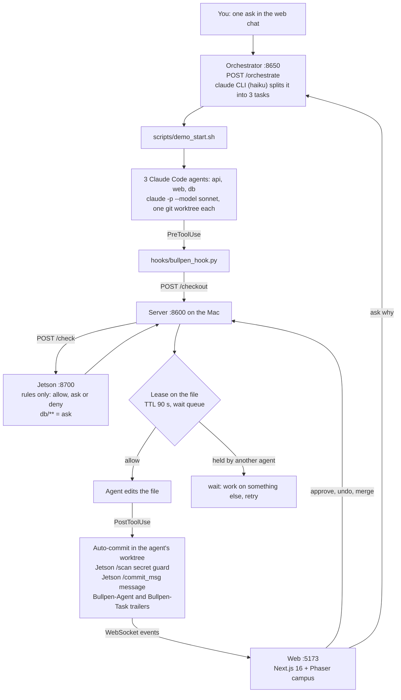

# Bullpen

**Version control for AI agents.** You give one orchestrator an ask. It starts 3 Claude Code agents, each in its own git worktree and branch, and a referee on a Jetson checks every edit: file locks, guarded folders, an auto-commit per edit, per-agent undo, and merge with a stated intent.

Built at HackJam '26 (USF Tampa, Nov 21, 2026). Track: Best Overall. Q&A cheat sheet: [`docs/TECH.md`](docs/TECH.md).

## The problem

- **Agents in separate worktrees** each open a PR, and the PRs conflict with each other. You find out at merge time.
- **Agents in one checkout** silently overwrite each other. Our scripted replay of the demo's three tasks loses **2 of 10 edits** with zero history entries ([`docs/BASELINE.md`](docs/BASELINE.md); a deterministic replay of the interleaving, not a live agent run).
- **No history** of which agent changed what, or why.

Git was built for humans. Bullpen puts a referee in front of every agent edit:

- **File leases.** One agent holds a file at a time (TTL 90 s). A second agent waits in a queue.
- **Guarded folders.** An edit in `db/` needs a human to approve it. No answer in 60 s means deny.
- **Auto-commit per edit.** Every edit is a commit with `Bullpen-Agent` and `Bullpen-Task` trailers.
- **Per-agent undo and merge.** Undo one agent's whole branch, or merge it with an intent summary.
- **Ask why.** Ask what an agent is doing; a local model answers from the event log.
- **A live map.** The repo is the USF campus: each top-level folder is a building, `main` is the campus, each agent's branch is a colored layer.

> Your sub writes the code. The Jetson keeps it honest, free, and private.

## Architecture



- **Fail closed.** Server down, Jetson down, or a bad reply: the hook denies the edit.
- **Contract.** Every request, response and event is in [`shared/events.md`](shared/events.md).

| Service | Port |
|---|---|
| Web (Next.js + Phaser) | 5173 |
| Server (FastAPI, leases, git) | 8600 |
| Orchestrator (FastAPI + `claude` CLI) | 8650 |
| Jetson (FastAPI + Ollama) | 8700 |

## What you see, and what is real underneath

The pixel campus is the hero. Next to it is a live evidence panel, and every animation on the map maps to real data:

| Panel | What it shows | Where it comes from |
|---|---|---|
| Commit timeline | Each agent's commits, with Undo and Merge per agent | Real git commits with `Bullpen-Agent` and `Bullpen-Task` trailers |
| Leases and approvals | Who holds which file, the countdown, who waits, what needs your approval | The server's lease table |
| Jetson referee log | Every decision with the matched rule, latency and model. Unplug the Jetson and it shows OFFLINE, and every edit is denied | The Jetson's `/check` replies |
| Building click | Zooms inside: rooms are subfolders or hot files, each agent sits at the file it is editing under a sign with its branch, with a live log of its actions and the real diff | Leases, hook events, `git diff main...<branch>` |

**Point it at any repo and it builds your campus.** `scripts/make_campus.py` scans the repo, ranks the top-level folders by file count, and puts the top 7 into fixed USF building slots. The guarded folder (`db/`) takes the Sun Dome, root files go to the Bull Runner stop, and everything else goes into one Annex building. The same repo always gives the same layout.

## Models

| Job | Where | Model |
|---|---|---|
| The 3 agents | Claude Code (`claude` CLI) on the user's Claude Max subscription, OAuth login, no API key | Claude Sonnet (`--model sonnet` in `scripts/demo_start.sh`, override with `BULLPEN_AGENT_MODEL`) |
| Orchestrator split | Claude Code (`claude` CLI), same subscription | Claude Haiku (`--model haiku` in `orchestrator/main.py`) |
| Referee `/check` and secret guard `/scan` | Jetson Orin Nano Super | rules only, no model |
| Commit messages `/commit_msg` | Ollama on the Jetson | qwen2.5-coder:3b |
| Branch intent `/summarize` | Ollama on the Jetson | llama3.2:3b |
| Ask why `/ask` | Ollama on the Jetson | nomic-embed-text + llama3.2:3b |

All Jetson chat calls use `num_ctx` 4096, so the three models stay loaded together in 8 GB. Each model is an env var in [`jetson/README.md`](jetson/README.md).

## How to run

1. Create the demo repo and its 3 worktrees, with the hook wired in: `./scripts/make_demo.sh` (creates `../demo`, `../demo-api`, `../demo-web`, `../demo-db`).
2. Start the server: `cd server && uv sync && BULLPEN_RELEASE_ON_COMMIT=0 uv run uvicorn main:app --host 0.0.0.0 --port 8600`. The env var keeps a lease until Stop, undo or expiry, so the collision is visible (see [`docs/TECH.md`](docs/TECH.md)).
3. Start the orchestrator: `cd orchestrator && uv sync && uv run uvicorn main:app --port 8650`. It needs a logged-in `claude` CLI.
4. Start the Jetson service per [`jetson/README.md`](jetson/README.md) (`JETSON_URL`, default `http://192.168.55.1:8700`).
5. Start the web app: `cd web && npm install && npm run dev`, then open http://localhost:5173 (`/` landing, `/campus` dashboard, `/campus?fake` scripted demo with no server). Click a suggested ask in the chat box, or run `scripts/demo_start.sh` for the canned tasks. Reset between runs with Settings, Reset demo, or `scripts/demo_reset.sh`.

## Repo layout

```
campus/        campus.json: folder -> building map
demo-seed/     the seed app the demo agents work on
design/        Caua's campus design prototype and mockups
docs/          DEMO.md: demo script; BASELINE.md: lost edits without Bullpen; TECH.md: Q&A
hooks/         bullpen_hook.py: the Claude Code hook
jetson/        referee and local-model service (runs on the Jetson)
orchestrator/  chat ask -> 3 tasks -> agents (port 8650)
scripts/       demo repo, demo kit and campus generator
server/        referee backend and event hub (runs on the Mac), with tests
shared/        events.md: the contract between every part
video/         backup demo video pipeline (Remotion)
web/           Next.js + Phaser campus view
```

## Team

| Who | Owns |
|---|---|
| Dev ([@builtbyd3v](https://github.com/builtbyd3v)) | All AI work: the orchestrator, agent launching, the Jetson and every model call on it. Also the hook, the demo kit, and integration (reviews and merges every PR). |
| Monisha ([@Monisha-Repos](https://github.com/Monisha-Repos)) | `server/`: leases, approvals, auto-commit, undo, merge, state and events. |
| Caua ([@caua-fm234](https://github.com/caua-fm234)) | `web/` and design: the campus view, side panel and sprites. |

## Demo

One ask to the orchestrator starts three agents. Two of them collide on one file and one waits. The db agent hits the guarded Sun Dome, gets denied, and adapts. We ask why, undo one agent, merge another, then unplug the Jetson and every edit stops. The full script is in [`docs/DEMO.md`](docs/DEMO.md).

## Credits: AI tools and frameworks

Everything in this repo was built during HackJam '26, starting at 11:00 AM on Nov 21, 2026.

**AI tools we used to build it**

- **Claude Code** (Anthropic), with the Claude Opus 5.5, Claude Fable 5.2, Claude Sonnet 5.5 and Claude Haiku 5.5 models, run through T3 Code and the Claude Code extension for VS Code. It wrote most of the code, docs, tests and design mockups, and reviewed its own changes, under our direction. We set the product, the architecture, the contract in `shared/events.md`, the work split and the demo, and we reviewed and tested what it produced.

**AI the product uses at run time**

- **Claude Code** (`claude` CLI, on the user's subscription): Claude Sonnet runs the three demo agents, and Claude Haiku splits the ask into tasks in the orchestrator.
- **Local models through Ollama on the Jetson**: qwen2.5-coder:3b (commit messages), llama3.2:3b (branch intent and ask-why), nomic-embed-text (ask-why retrieval). lfm3:1.7b was used during development.

**AI used for the demo video**

- **ElevenLabs** text to speech for the voiceover (stock library voice "Misa", model eleven_multilingual_v2).
- macOS `say` for placeholder voiceover only.

**What Bullpen is not:** it is not a reskin of an AI tool. Claude Code is the agent being controlled. What we built is the layer around it: the hook, the referee and its rules, file leases, approvals, auto-commits, undo and merge, the orchestrator, and the campus view.

**Frameworks and libraries**

- Web: Next.js 16, React 19, TypeScript, Tailwind CSS 4, Phaser 3, Node.js.
- Design prototype: HTML, CSS and JavaScript, with the Pixelify Sans and Press Start 2P fonts from Google Fonts; Python with Pillow for the mockup sprite generator (`design/mockups-v3/sprites/make_sprites.py`).
- Server, orchestrator and Jetson: Python, FastAPI, uvicorn, websockets, httpx, pydantic, uv.
- Models: Ollama. Voice input and output (whisper.cpp, Piper) was planned as a stretch goal and not built.
- Video: Remotion, React, TypeScript, ffmpeg, and Playwright (`playwright-core`) to drive Chrome for the automated video recorder.
- Testing: pytest (Jetson, orchestrator), Python unittest (server), the Node.js test runner (web).
- Tooling: git worktrees, tmux, GitHub Actions, ruff, npm.
